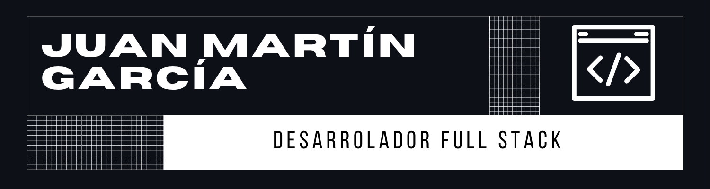

<!-- BANNER PRINCIPAL -->

  

  

### Sobre mí

- Actualmente cursando la Tecnicatura en Programación en la **UTN Mendoza**.
- Profundizando mis conocimientos en el desarrollo backend con **Java y Python**.
- Desarrollo páginas web con **HTML, CSS y JavaScript**.
- Apasionado por la construcción de arquitecturas sólidas y la gestión eficiente de datos.
- Integro agentes de IA en mis proyectos, aplicando desarrollo guiado por especificaciones (SDD), orquestación de agentes y gestión de contexto.
- Pregúntame sobre **Spring Boot, SQL o lógica de programación**.
- Dato curioso: Mi máxima productividad programando siempre llega en los días fríos y nublados con un buen café.

 

 

### Tecnologías y Herramientas

  <b>Lenguajes</b> &nbsp;&nbsp;&nbsp;
  
  
  

  <b>Desarrollo web</b> &nbsp;&nbsp;&nbsp;
  
  
  

  <b>Frameworks y Bases de Datos</b> &nbsp;&nbsp;&nbsp;
  
  

  <b>Herramientas</b> &nbsp;&nbsp;&nbsp;
  
  
  
  

 

 

### Desarrollo con IA

Utilizo agentes de IA para acompañar el desarrollo de software: desde el análisis de requisitos y la planificación hasta la implementación y revisión de cambios.

- **Spec-Driven Development (SDD):** defino especificaciones, criterios de aceptación y tareas para guiar el desarrollo.
- **Orquestación de agentes:** coordino agentes y subagentes con responsabilidades específicas para analizar, diseñar, implementar y verificar soluciones.
- **OpenSpec:** organizo especificaciones y propuestas de cambio para mantener alineados los requisitos y el código.
- **Engram:** conservo contexto y decisiones técnicas entre sesiones de trabajo con agentes.
- **Revisión y validación:** reviso las soluciones propuestas y verifico su funcionamiento mediante pruebas.

Combino estas herramientas con mis conocimientos de backend, arquitectura y bases de datos, manteniendo el control sobre las decisiones técnicas y la calidad del código.

 

 

<!-- CONTACTO Y REDES -->

  <h3>Conecta conmigo</h3>
   
  
  &nbsp;&nbsp;&nbsp;
  

 

  

